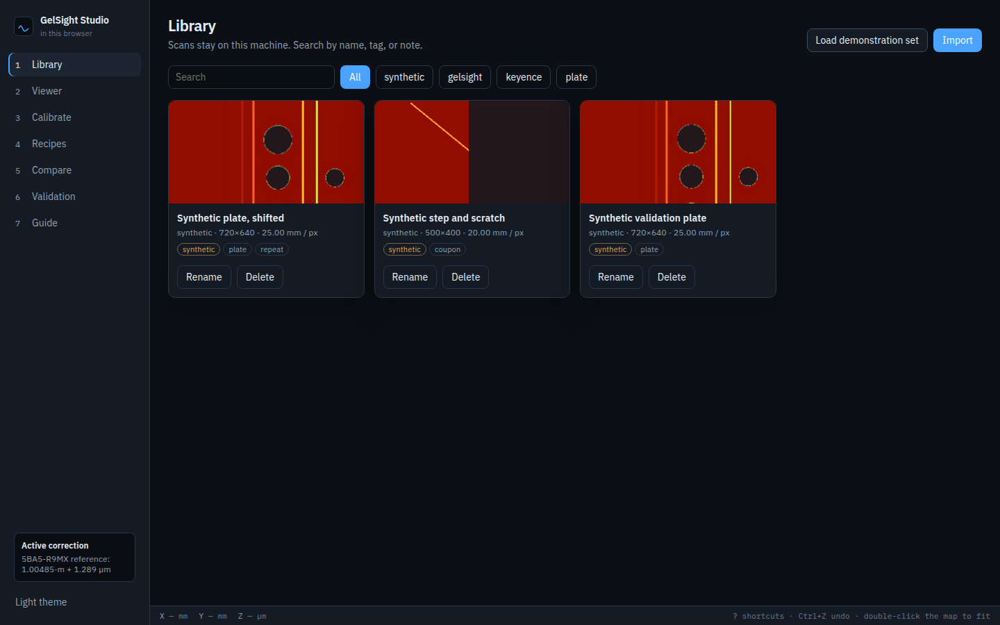
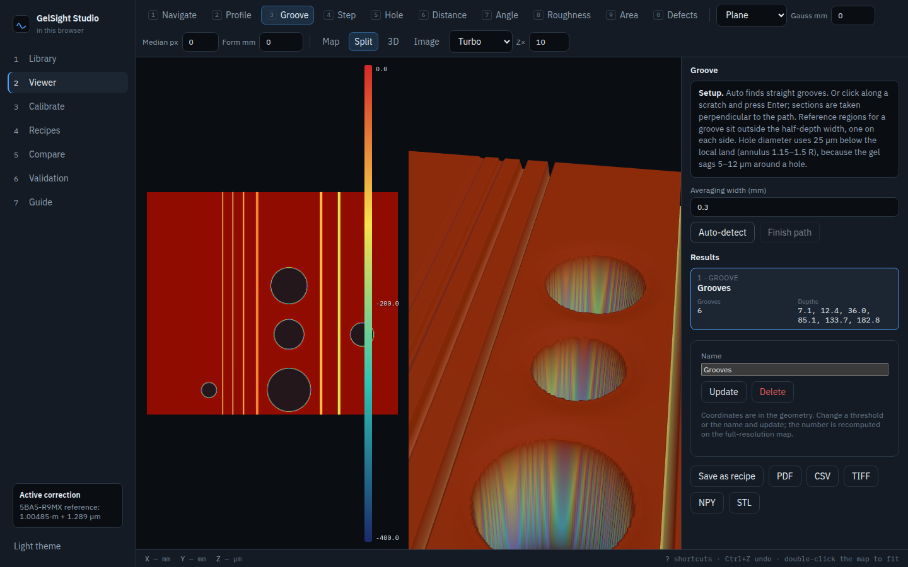
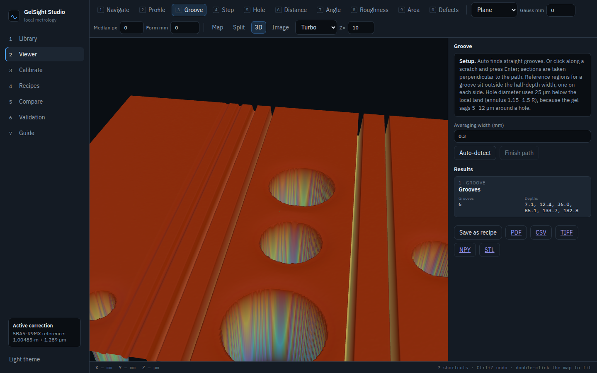
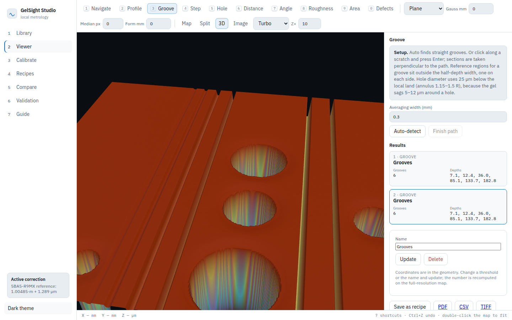
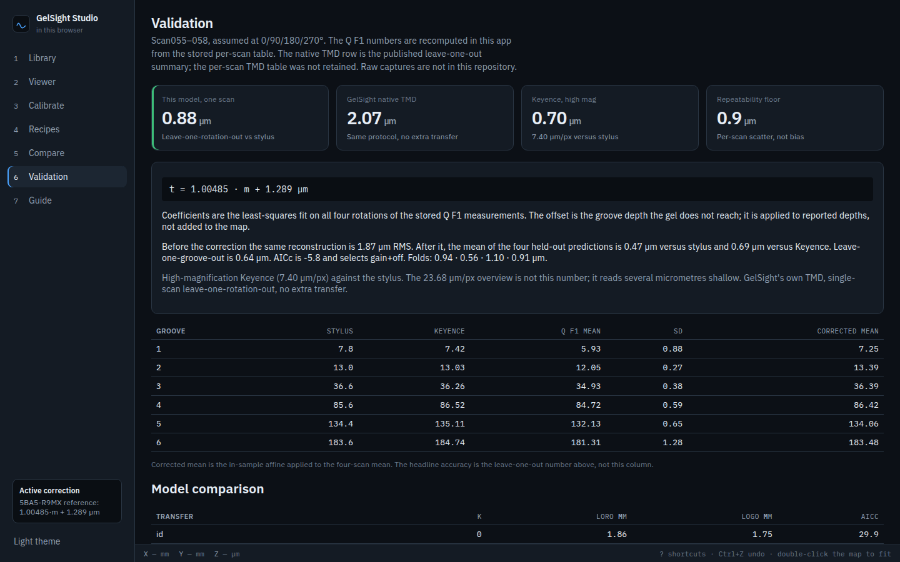
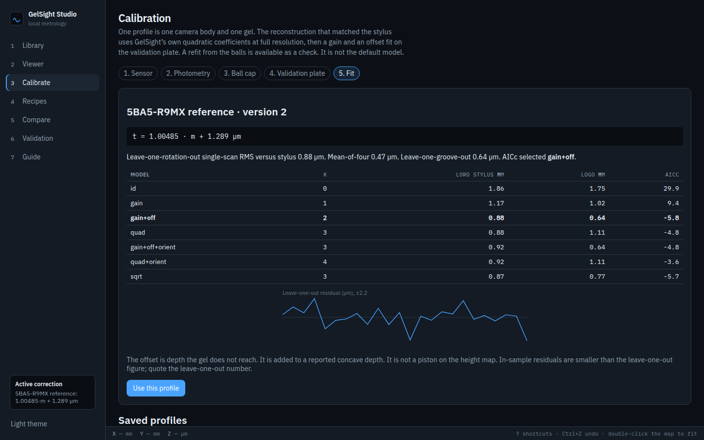
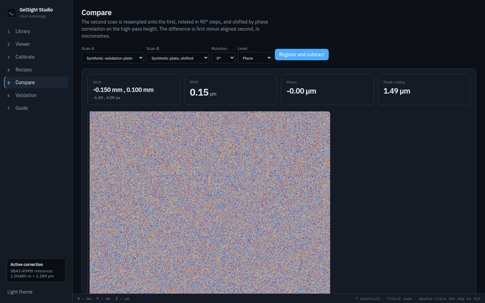

# GelSight Studio

A browser-only app for GelSight tactile height maps. Import a scan, level it, measure grooves, steps, holes and roughness, save the setup as a recipe, and compare the result with a stylus or a Keyence map. All of that runs in the page. A scan opened from disk stays in this browser.

It is not affiliated with GelSight, Inc. No raw scan from the study is in this repository. The numerical model is the one recorded in [`reference/experiment_log.md`](reference/experiment_log.md).

## Hosted

<https://stephencoan8.github.io/gelsight-studio/>

The site is a GitHub Pages build of this repo. [`.github/workflows/pages.yml`](.github/workflows/pages.yml) builds the Vite app and deploys `frontend/dist` on every push to `main`. The Vite `base` is `/gelsight-studio/`.

Pages has to be turned on after the repository is public: Settings → Pages → Build and deployment → Source: GitHub Actions. Until that is enabled, the URL will not serve the app. Nothing in the workflow publishes the repository for you.

## Run locally

Node 20 or newer.

```bash
./run.sh dev
```

Opens Vite at <http://127.0.0.1:5173/gelsight-studio/>.

```bash
./run.sh          # production build, preview at http://127.0.0.1:8000/gelsight-studio/
./run.sh test     # vitest, then the TypeScript production build
```

Docker serves the same static build:

```bash
docker compose up --build
```

That listens on <http://127.0.0.1:8080/gelsight-studio/>.

The first screen is empty. **Load demonstration set** builds a synthetic validation plate (tagged synthetic) so the tools can be tried without a sensor. The validation page does not use that plate. It recomputes the published comparison from the stored per-scan table.

Scans, calibrations, measurements, and recipes are stored in IndexedDB. Height maps and the six raw frames, when a GelSight folder includes them, go in the origin private file system (IndexedDB if that API is missing). Closing the tab does not upload them.

## The model

Photometry is GelSight’s own quadratic calibration (`quadfit` in `Calib-*.yaml`), at full resolution, with no slope clamp. Height is the Neumann Poisson integral of the slopes, multiplied by

```text
K = camera millimetres per pixel / scan millimetres per pixel
```

Concave depths then take the two-parameter plate correction fit on Scan055–058 (0°/90°/180°/270°):

```text
t = 1.00485 · m + 1.289 µm
```

The offset is depth the gel does not reach. It is applied to a reported depth. It is not added to the height map.

| Comparison | Single-scan RMS vs stylus |
|---|---|
| This model, leave-one-rotation-out | **0.88 µm** |
| GelSight native TMD, same protocol | 2.07 µm |
| Keyence, 7.40 µm/px | 0.70 µm |

Leave-one-groove-out is 0.64 µm. The mean of the four held-out predictions is 0.47 µm versus the stylus. AICc selects gain and offset. The repeatability floor is about 0.9 µm. These Q F1 figures are recomputed in the page from `reference/E00_GSQ_F1.json`. The native TMD row is the published summary; that per-scan table was not retained.

The normal solve is the C kernel in `frontend/wasm/solve.c`, compiled to WebAssembly and run across Web Workers (up to 6, or fewer if the machine has fewer cores). Poisson is `frontend/wasm/poisson.c`: orthonormal DCT-II, the same divergence stencil and eigenvalues as the study. A 16-bit PNG is decoded in the page. Drawing it to a canvas would keep only 8 bits, which ruins the flat field.

Reference balls are inset in a plate. Only the top cap is a sphere. Samples within 0.05 R of the contact edge are excluded, and a ball whose contact radius is below 0.5 R is dropped.

A fixed 3 or 10 µm threshold overestimates a hole diameter: the gel sags 5–12 µm in a skirt out to about 1.5–2 radii. The hole tool reports the contour 25 µm below the local land (annulus 1.15 R to 1.5 R). In-hole depth is the gel surface, not the bottom of a hole the gel cannot enter.

## What the screens show

Library after **Load demonstration set**. Those scans are generated in the page. They are not Scan055–058.



Height map after automatic groove measurement on the synthetic plate. The panel reported 7.1, 12.4, 36.0, 85.1, 133.7, 182.8 µm against the stylus depths 7.8, 13.0, 36.6, 85.6, 134.4, 183.6 µm.



The same plate in the 3D view. Lighting, colour, and vertical exaggeration are live.



Light theme.



Validation. 0.88 µm is recomputed, not typed in.



Calibration profile for gel 5BA5-R9MX. Gain and offset win the model table.



The demonstration plate compared with a copy shifted by 4 rows and −6 columns. Phase correlation recovers that shift. The residual is the noise added to the copy, about 0.15 µm RMS.



## Browser timings

Headless Chrome on this 4-core machine, synthetic buffers (Scan055’s images are not in the repo). The page is `bench.html` in a production build.

| Kernel | This run |
|---|---|
| Poisson, 514×616 (factor-4 preview) | 230 ms |
| Poisson, 2056×2464, one WASM instance | 1.47 s |
| Same Poisson split across 4 workers | 1.67 s, max abs difference 0 |
| Normal solve, 1 worker | 60,600 px/s (20,000 px in 330 ms) |
| Normal solve, 4 workers | 196,000 px/s (80,000 px in 408 ms) |

A full 2056×2464 normal solve at the 4-worker rate is about 26 s, plus the 1.5 s integral. The earlier Scan055 benchmark (6 workers, 8-core VM) measured 86 s full resolution and 1.8 s at factor 4, against 133 s and 10.5 s for the numpy app, with heights matching to about 2×10⁻⁶ µm RMS. Pyodide was several times slower and is not on this path.

Worker-split Poisson lost to one WASM instance here. GitHub Pages cannot set the headers shared memory needs, so each worker gets a copy of its rows. Those copies cost more than the DCT saves on 4 cores. The app integrates in one WASM instance. The normal solve does use the worker pool: pixels are independent and the pool was 3.2× faster than one worker.

## Tools

Each tool has a short setup in the side panel. Results stay editable: rename them, change a threshold, update, and the number is recomputed on the stored map. Annotations are drawn on the view.

| Tool | What it reports |
|---|---|
| Profile | Line or band-averaged profile, length, peak-to-valley, Ra, Rq |
| Groove | Straight grooves automatically, or a polyline scratch. Each section uses left and right reference regions outside the half-depth width. Min, mean, max, standard deviation |
| Step | Difference of the two outer reference regions, after a common slope that does not absorb the step |
| Hole | Diameter at 25 µm below the local land, plus the wall-line estimate and the sag |
| Distance, angle | Lateral distance, Δz, and the plane angle |
| Roughness | Sa, Sq, Sz on a rectangle, Ra and Rq on its mid profile |
| Area | Area and volume below the boundary |
| Defects | Connected regions past a threshold under the robust land |

Plane, polynomial, and region levelling, plus Gaussian, median, and wide-Gaussian form removal, are applied before a measurement when you turn them on. Roughness is the discrete definition on that surface. It is not a certified ISO 16610 Gaussian-filter chain.

A recipe stores those steps and runs them on other scans in the same fixture frame. Reports download as PDF, CSV, and JSON. Height maps download as TIFF (float32), NPY, CSV, PNG, and a decimated STL.

A GelSight folder with six images and an active sensor profile can be reconstructed in the viewer. **Preview** is factor 4. **Full res** is the published model and asks for confirmation.

## Keyboard

`1`–`0` select the tools in the order above. `[` `]` change vertical exaggeration. `M` `V` `S` switch map, 3D, and split. `I` shows the original image when a GelSight folder had one. `Enter` finishes a scratch path, `Esc` cancels it, `Delete` removes the selected result. `Ctrl+Z` undoes a measurement, `Ctrl+Shift+Z` redoes it. `T` toggles the theme. `?` opens the shortcut list. `Alt+1`…`Alt+7` switch sections. Double-click the map to fit it.

## Tests

`./run.sh test` runs vitest and the production build. The tests cover:

- Q F1 leave-one-rotation-out matches the published table (0.88 µm, AICc −5.8, gain 1.00485, offset 1.289 µm).
- The Poisson WASM kernel matches a SciPy fixture to 1×10⁻⁹, and the split DCT path matches the single call.
- The solve kernel recovers a known normal.
- A rectangular trench, a sagging hole, and the synthetic plate.
- 16-bit decode of the reference flat field (1848×1028, samples 9578…31883, not an 8-bit truncation) and the quadfit block (360 values, gel 5BA5-R9MX).
- Cap mask, sphere scale, roughness of a sine, NPY and float TIFF round-trip, TMD header, phase correlation.

The Python package under `gelsight/` is a reference for the same model. `pytest` still runs it. The app does not start that server.

## File formats

- GelSight folder: `scan.yaml`, `image01`–`image06`, and an optional `.tmd` height in millimetres. The reference profile (gel 5BA5-R9MX, camera CIMAF2440014) is loaded from the files shipped in `frontend/public/reference/`. Its flat field is decoded as 16-bit.
- Keyence `.zag`: a zip containing 1024×768 little-endian int32 height maps. Invalid sentinels become NaN. Pixel size is `MeterPerPixel`. The 23.68 µm/px overview is not the 0.70 µm groove number.
- TIFF (uncompressed 8/16-bit or float32), PNG (8- or 16-bit, decoded without canvas), CSV, NPY, and GelSight TMD. You set millimetres per pixel and the file’s height unit when the file does not carry them.

## Gaps

- Scan055–058 and the ball, flat, and groove calibration captures are not in this repository. The 0.88 µm figure is the transfer applied to the stored groove depths, not a fresh reconstruction of those images. Full-resolution reconstruction of a 5-megapixel capture is implemented. On this machine the normal-solve rate implies about 26 s plus the 1.5 s integral. That full grid was not timed end to end, because the images are not here.
- Poisson across workers was slower than one WASM instance on 4 cores, so the integrator does not use the pool. Shared memory would avoid the copies, and GitHub Pages will not send the required headers.
- Compressed TIFF is rejected with an error that asks for uncompressed float32 or CSV. Interlaced PNG is rejected the same way.
- On holes, the study’s Poisson integration was worse than GelSight’s native height (loc25 about 127 µm versus 49 µm against Keyence). The diameter rule is the same.
- There is no live connection to a sensor. Import is from files GelSight Mobile or Scan already wrote.
- Undo covers measurements created in the open session.
- The Python FastAPI app is no longer what `./run.sh` starts. It remains in the tree as the numerical reference.
